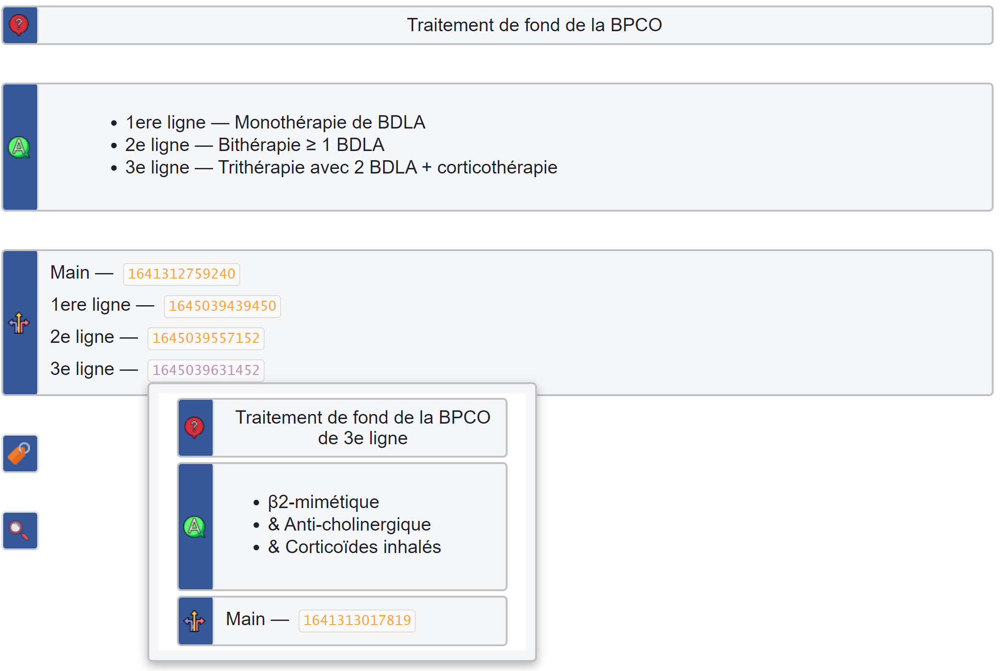
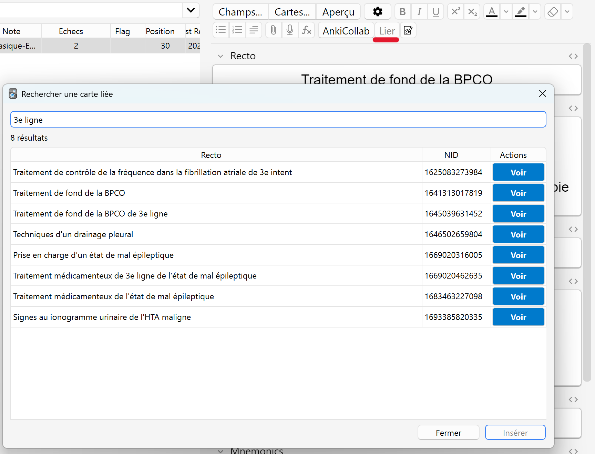

# Anki EDN - Lier les Cartes

**Recherche et liaison rapide de cartes pour Anki**

Cet addon permet de créer des liens entre vos cartes Anki facilement, facilitant la navigation et l'interconnexion de vos connaissances.

## ✨ Fonctionnalités

### 🔗 Liaison de cartes et Description intelligente
- **Recherche rapide** : Trouvez et liez des cartes en quelques secondes.
- **Aperçu des cartes liées** : Survolez un hyperlien pour afficher instantanément un aperçu interactif de la carte liée.
- **Liens cliquables** : Cliquez sur un hyperlien dans le reviewer pour ouvrir la carte dans le browser.
- **Copie de NID** : Copiez facilement l'identifiant d'une carte.
- **Description intelligente (EDN uniquement)** : Extrait en priorité le contenu du champ C2 (sinon C1) pour les clozes, et remplace dynamiquement le texte du lien par des mentions explicites comme 'Main', 'Signes', 'Traitements' selon le contexte.

### 🃏 Réglages Visuels des Cartes (EDN uniquement)
Accessible depuis le menu `Anki EDN > Réglages Cartes EDN` ou les `Paramètres EDN` :
- ⚫ **Barre de rang** : Colore la barre verticale du premier champ en fonction du rang de la carte (Noir = Rang A, Bleu = Rang B, Vert = Rang C, Gris = non classé).
- 🧩 **Pictogrammes de matière** : Affiche les pictogrammes/émojis des spécialités médicales correspondantes juste au-dessus du recto (désactivable sur ordinateur et activable sur mobile).
- 🎴 **Bordures par drapeaux** : Encadre la carte de la couleur du drapeau Anki actif (prend en charge les 7 drapeaux).
- 💾 **Synchronisation multi-appareils** : Les préférences sont automatiquement enregistrées dans votre dossier média (`_edn_prefs.js`) et dans une note sentinelle pour être chargées sur AnkiMobile (iOS/Android).

### ⌨️ Raccourcis personnalisables
- `Ctrl+Alt+L` : Ouvrir le dialogue de recherche (ou lier directement si un NID est sélectionné).
- `Ctrl+Alt+C` : Copier le NID de la carte sélectionnée dans le browser.
- `nid:` : Tapez ces 4 caractères dans l'éditeur pour ouvrir automatiquement le dialogue de recherche.

## 📦 Fonctionnalités intégrées

Cet addon intègre les fonctionnalités suivantes (aucune installation externe requise) :
- [**Link Cards**](https://ankiweb.net/shared/info/1170639320) : Fonctionnalités complètes de liaison.
- [**Open Multiple Windows**](https://ankiweb.net/shared/info/354407385) : Support multi-fenêtres pour le browser.
- [**Learn Now**](https://ankiweb.net/shared/info/1021636467) : Intégration des options "Apprendre maintenant" et "Noter la carte" (désuspend automatique inclus) au clic droit sur les miniatures de profil et badges NID.

Il propose également une intégration avec :
- [**BetterSearch**](https://ankiweb.net/shared/info/1052724801) : Intégration de la recherche améliorée, auto-complétion et suggestions d'opérateurs dans la barre de recherche du dialogue (si installé).

## 🚀 Installation

### Via AnkiWeb
1. Allez dans `Outils > Modules complémentaires > Acquérir des modules complémentaires...`
2. Entrez le code : `445658251` 
3. Redémarrez Anki

### Depuis le fichier .ankiaddon
1. Téléchargez le fichier `.ankiaddon` depuis le répertoire local ou les releases.
2. Dans Anki, allez dans `Outils > Modules complémentaires > Installer depuis un fichier...`
3. Sélectionnez le fichier `.ankiaddon` généré.
4. Redémarrez Anki.

## 📖 Guide d'utilisation

### Lier une carte

**Méthode 1 : Via le dialogue de recherche**
1. Placez votre curseur dans l'éditeur.
2. Appuyez sur le bouton `Lier`, ou le raccourci `Ctrl+Alt+L`, ou tapez `nid:`.
3. Recherchez la carte que vous voulez lier.
4. Cliquez sur "Insérer" ou double-cliquez sur la ligne de la carte.

**Méthode 2 : Liaison rapide**
1. Copiez le NID d'une carte (`Ctrl+Alt+C` dans le browser).
2. Collez-le dans l'éditeur.
3. Sélectionnez le NID et appuyez sur `Ctrl+Alt+L`.
4. Le lien est créé automatiquement.

### Naviguer via les liens

Dans le reviewer, passez la souris sur le lien pour afficher sa miniature de profil (aperçu interactif), ou cliquez sur l'hyperlien pour ouvrir la carte liée dans une fenêtre séparée du browser.

### Personnaliser les raccourcis

1. Ouvrez le menu `Anki EDN > ⚙️ Paramètres EDN...`
2. Allez dans l'onglet "⌨️ Raccourcis".
3. Modifiez les raccourcis selon vos préférences.
4. Cliquez sur "✅ Appliquer" et redémarrez Anki.

## 📄 Licence

Creative Commons Attribution-ShareAlike 4.0 International (CC BY-SA 4.0).

Vous êtes libre de :
- **Partager** : copier et redistribuer le matériel sous quelque support que ce soit.
- **Adapter** : remixer, transformer et créer à partir du matériel.

## 💡 Support

Pour toute question, suggestion ou rapport de bug :
- [Anki EDN Documentation](https://tools.c2su.org/Anki_EDN/book/)
- [Discord Anki EDN](https://discord.gg/2A7zHAEBYt)
- [GitHub Repository](https://github.com/C2SU/Anki_EDN_Lier_Les_Cartes)
- [AnkiWeb Page](https://ankiweb.net/shared/info/445658251)