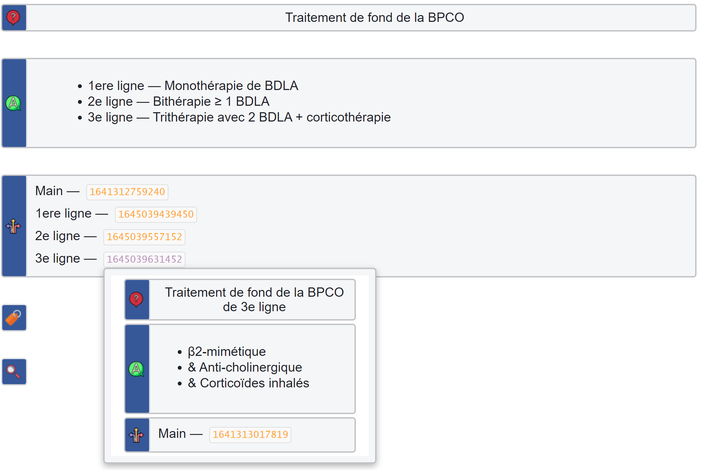
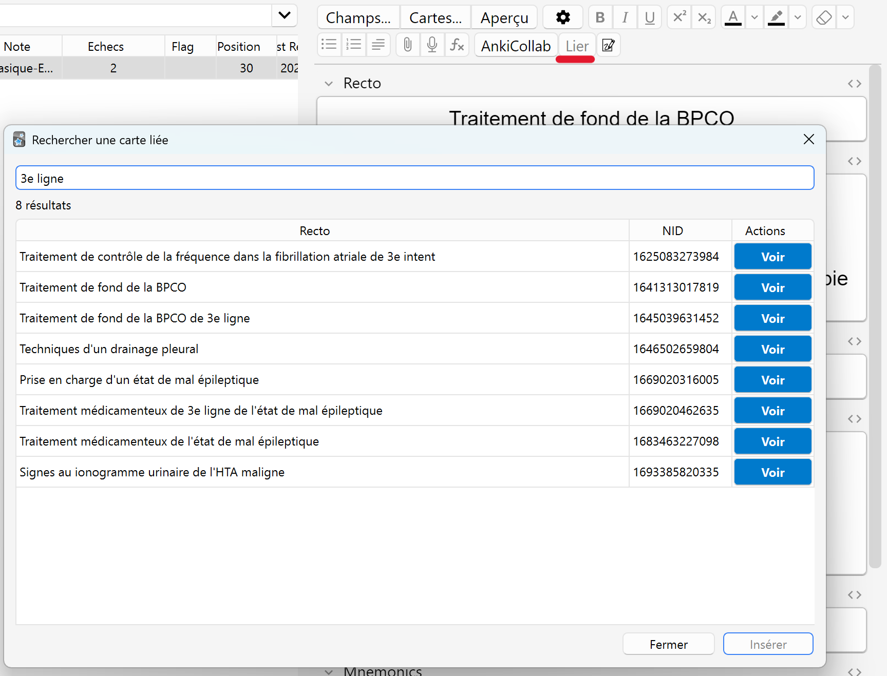

# Anki EDN - Lier les Cartes

Interconnectez vos connaissances medicales et naviguez instantanement entre vos cartes.

Cet add-on permet d'inserer des liens bidirectionnels intelligents entre vos cartes Anki et d'afficher un apercu complet au survol de la souris sans jamais interrompre votre session de revision.

---

## Demarrage Rapide en 3 Etapes

| Etape | Intitule | Action a realiser |
| :--- | :--- | :--- |
| **Etape 1** | **Declenchez la recherche** | Dans l'editeur de carte, cliquez sur le bouton **Lier**, appuyez sur `Ctrl+Alt+L`, ou tapez simplement `nid:` dans le texte. |
| **Etape 2** | **Selectionnez la cible** | Tapez vos mots-cles dans la boite de recherche predictive avec filtrage direct par paquet, puis double-cliquez pour inserer le lien. |
| **Etape 3** | **Survolez en revision** | En cours d'etude, survolez l'hyperlien pour inspecter la fiche liee en miniature, ou cliquez pour l'ouvrir dans une fenetre separee. |

---

## Fonctionnalites Cles

- **Apercu interactif au survol** : Affiche une miniature flottante de la note cible lors du passage du curseur sur le lien, sans quitter l'ecran de revision ni briser le rythme de memorisation.
- **Description contextuelle intelligente** : Extrait automatiquement l'intitule de la clause pertinente (champ C2 prioritaire pour les cartes EDN) et formate le texte du lien selon l'orientation clinique (Diagnostic, Signes, Traitement).
- **Recherche filtree & multi-fenetres** : Module de recherche rapide integre et ouverture des cartes liees dans des fenetres navigatrices independantes.
- **Action Learn Now integree** : Clic droit sur une miniature de lien pour declencher l'apprentissage immediat de la carte associee sans perturber la file d'attente courante.
- **Personnalisation visuelle EDN** : Reglage des barres verticales de rang (Rang A, Rang B, Rang C) et encadrements discrets par drapeau.

---

## Raccourcis Clavier

| Raccourci | Contexte | Action realisee |
| :--- | :--- | :--- |
| `Ctrl + Alt + L` | Editeur de note | Ouvrir la fenetre de recherche et d'insertion de lien |
| `Ctrl + Alt + C` | Navigateur (Browser) | Copier l'identifiant unique (NID) de la note selectionnee |
| `nid:` | Champ texte | Declenchement textuel direct de la recherche |

---

## Installation

### Via AnkiWeb (Recommande)
1. Dans Anki, ouvrez le menu `Outils > Modules complementaires > Acquerir des modules complementaires...`
2. Saisissez le code : **445658251**
3. Redemarrez Anki.

### Depuis le fichier .ankiaddon
1. Telechargez le fichier `.ankiaddon` depuis les releases locales ou GitHub.
2. Dans Anki, ouvrez `Outils > Modules complementaires > Installer depuis un fichier...`
3. Selectionnez le package et redemarrez Anki.

---

## Assistance et Documentation

- Code d'installation AnkiWeb : **445658251**
- Documentation officielle EDN : [Portail Anki EDN](https://c2su.github.io/Anki_EDN/Anki_EDN.html)
- Communaute d'entraide : [Serveur Discord EDN](https://discord.gg/2A7zHAEBYt)
- Code source : [Depot GitHub C2SU/Anki_EDN_Lier_Les_Cartes](https://github.com/C2SU/Anki_EDN_Lier_Les_Cartes)
- Licence : Creative Commons Attribution-ShareAlike 4.0 International (CC BY-SA 4.0)
